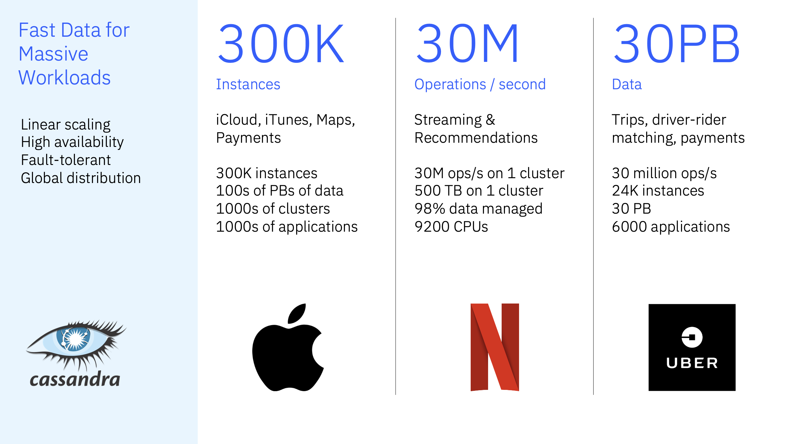

# Cassandra training — architecture and data modeling

## About Apache Cassandra

[Apache Cassandra](https://cassandra.apache.org/) is an open source, **distributed wide-column** database designed for **massive scale**, **high availability**, and **predictable low latency** on commodity hardware or in the cloud. It uses a **masterless**, peer-to-peer topology: every node can serve reads and writes, and data is replicated across the cluster with **tunable consistency** so applications can trade latency against how many replicas must agree on each operation.

People use Cassandra as an **operational data store** for live workloads—time series and metrics, event logging, product catalogs, session and profile data, messaging back ends, IoT ingestion, and increasingly **AI/ML** and retrieval-style pipelines where throughput and uptime matter more than ad-hoc relational joins. The project describes it as trusted by **thousands of companies** with large active data sets; release testing includes clusters of up to **1,000 nodes**. A public case study on the Cassandra site quotes **Bloomberg** serving **more than 20 billion requests per day** on a **~1 PB** dataset across **1,700+** nodes. The **2024 Apache Cassandra user survey** published **140** responses on use cases, deployment size, and experience. See [References](#references) for links.



## This repository

This repo is a **four-session course** (2 hours each) on one **three-node** open-source Cassandra cluster ([`docker-compose.yml`](docker-compose.yml)). **DSE is explained, not labbed.** The same CQL, drivers, and data model apply when the contact points are DSE nodes.

| Phase | Session | Who | File |
|-------|---------|-----|------|
| **1 — Common foundation** | 1 — What it is, where data lives | Developers, platform, SRE, support | [sessions/01-common-foundation.md](sessions/01-common-foundation.md) |
| **1 — Common foundation** | 2 — Consistency, topology, storage | Same | [sessions/02-consistency-topology-storage.md](sessions/02-consistency-topology-storage.md) |
| **2 — Application developer** | 3 — Query-driven design | Developers, architects, tech leads | [sessions/03-query-driven-design.md](sessions/03-query-driven-design.md) |
| **2 — Application developer** | 4 — CQL, drivers, tombstones, TTL | Same | [sessions/04-cql-drivers-performance.md](sessions/04-cql-drivers-performance.md) |

Index: [sessions/README.md](sessions/README.md).

[`architecture/`](architecture/README.md) and [`data-modeling/`](data-modeling/README.md) are the **reference library** (extra labs and the diagrams). Teach from `sessions/`. Open a reference module only when a session points at it.

## Start the lab cluster

From the repository root, with Docker Compose v2:

```bash
docker compose up -d
docker exec cassandra-1 nodetool status
```

Wait until all three nodes show **UN**, then:

```bash
docker exec -it cassandra-1 cqlsh cassandra-1 9042
```

Create `lab_ks` and `events` in [session 1](sessions/01-common-foundation.md). Later sessions assume that schema.

## Stop and reset

Stop and keep data:

```bash
docker compose stop
```

Remove containers and keep volumes:

```bash
docker compose down
```

Wipe lab data:

```bash
docker compose down -v
```

## Learning path

### Timed course

Follow [sessions/README.md](sessions/README.md). Each session file has the agenda, the explanation, and the labs for those two hours.

### Architecture (reference)

| Module | File |
|--------|------|
| 01 — Architecture and deployment | [01-architecture-and-deployment.md](architecture/01-architecture-and-deployment.md) |
| 02 — Lab environment | [02-lab-environment.md](architecture/02-lab-environment.md) |
| 03 — Masterless, peers, placement | [03-masterless-peers-and-placement.md](architecture/03-masterless-peers-and-placement.md) |
| 04 — CAP and tunable consistency | [04-cap-and-tunable-consistency.md](architecture/04-cap-and-tunable-consistency.md) |
| 05 — Gossip and topology | [05-gossip-and-topology.md](architecture/05-gossip-and-topology.md) |
| 06 — Storage engine (write/read, compaction, tombstones) | [06-storage-engine-write-through-read.md](architecture/06-storage-engine-write-through-read.md) |
| 07 — Self-healing, LWT, summary | [07-self-healing-lwt-and-summary.md](architecture/07-self-healing-lwt-and-summary.md) |

### Data modeling (reference)

| Module | File |
|--------|------|
| 01 — Intro and paradigm | [01-intro-and-paradigm.md](data-modeling/01-intro-and-paradigm.md) |
| 02 — Process and primary key | [02-process-and-primary-key.md](data-modeling/02-process-and-primary-key.md) |
| 03 — Placement and partition health | [03-placement-and-partition-health.md](data-modeling/03-placement-and-partition-health.md) |
| 04 — Clustering and wide partitions | [04-clustering-and-wide-partitions.md](data-modeling/04-clustering-and-wide-partitions.md) |
| 05 — Tombstones and denormalization | [05-tombstones-and-denormalization.md](data-modeling/05-tombstones-and-denormalization.md) |
| 06 — Anti-patterns | [06-anti-patterns.md](data-modeling/06-anti-patterns.md) |
| 07 — Checklist, labs, blueprint | [07-checklist-labs-and-blueprint.md](data-modeling/07-checklist-labs-and-blueprint.md) |

## Prerequisites

- Docker Desktop or Docker Engine **with Compose v2**
- About **6 GB** free RAM for the stack (`MAX_HEAP_SIZE` is **1G** per node in `docker-compose.yml`; three heaps plus off-heap need more than 4 GB)

## References

1. Apache Software Foundation, *Apache Cassandra* (homepage: scale, testing, and user quotes). [https://cassandra.apache.org/](https://cassandra.apache.org/)
2. Apache Cassandra community, *2024 User Survey Results* (October 2024, n=140). [https://cassandra.apache.org/_/blog/2024-User-Survey.html](https://cassandra.apache.org/_/blog/2024-User-Survey.html)

Thanks to **David Leconte** for the architecture images used in the Architecture modules.
