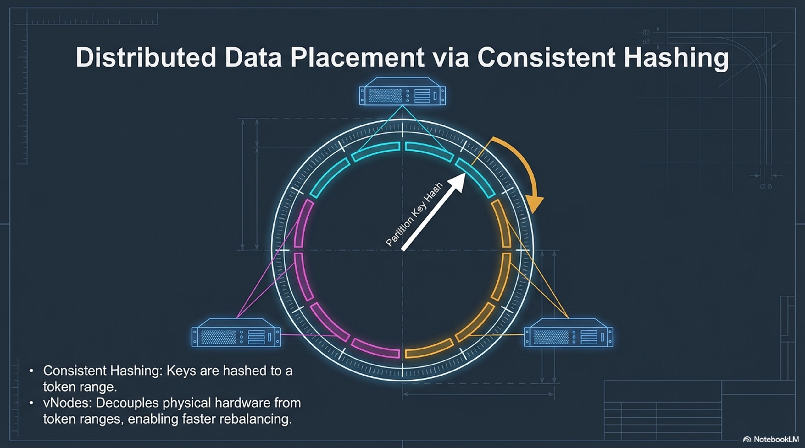

# Session 1 — Common foundation

**Phase 1.** Developers, platform engineers, SRE, and support.

**Duration:** 2 hours.

**Purpose:** A shared picture of Cassandra and of DSE, then proof on a cluster that any node can coordinate and that a partition key chooses the replicas.

**Cluster:** open-source Cassandra in Docker Compose. DSE is discussion only.

## You leave able to

- Say when Cassandra fits, and when a relational store or a warehouse fits better.
- Tell OSS Cassandra, DSE, HCD, and Astra apart without claiming they are different data models.
- Start the lab cluster, read `UN`, and create `lab_ks` at RF 3.
- Explain masterless placement: partition key → token → replicas.

## Agenda

| Minutes | Block |
|---------|--------|
| 0–15 | What it is good at |
| 15–35 | OSS, DSE, HCD, Astra |
| 35–70 | Lab — cluster and schema |
| 70–95 | Masterless ring |
| 95–120 | Lab — coordinator and endpoints |

**If you are behind:** skip the optional ring command in the last lab. Do not skip `getendpoints`.

---

## 1. What Cassandra is for

Cassandra is an operational store for live reads and writes at high throughput, with no master and with a consistency level chosen per request. Typical fits: events, time series, catalogs, sessions, messaging metadata, IoT ingest.

Poor fits, said plainly:

- Ad-hoc joins across arbitrary tables.
- Multi-key transactions as the default way to model the domain. Single-partition compare-and-set (LWT) exists; it is not a SQL transaction habit. Session 4 shows one.
- A small dataset with no availability requirement. A single-node SQL database is simpler.

Deeper narrative and the terms table: [architecture/01](../architecture/01-architecture-and-deployment.md).

---

## 2. OSS, DSE, HCD, Astra

Same CQL, same drivers, same partition rules. The difference is who runs the nodes and which extra products sit beside the database.

**Apache Cassandra (this lab).** You install and operate it. You own upgrades, repair, backups, and capacity.

**DataStax Enterprise (explain, do not lab).** A supported Cassandra distribution you still operate. The line most estates run is DSE 6.8 / 6.9 on a Cassandra 4.x core. Beyond the database, depending on what is enabled:

- OpsCenter and Lifecycle Manager for repair, backup, and metrics. Newer DataStax operations planes use Mission Control.
- Authentication, authorization, and encryption, often tied to LDAP or Kerberos.
- Workloads that share the same nodes: DSE Search (Solr), DSE Analytics (Spark), DSE Graph. They change capacity planning. A DSE node is not “Cassandra plus a logo” once Search or Analytics is on.

A correct schema and a correct driver configuration from this course are the right ones for DSE contact points. Nothing in the labs requires an OpsCenter UI or a Search index.

**HCD.** DataStax’s Kubernetes-native platform, still operated by you, on-prem or in your cloud account.

**Astra DB.** DataStax-operated Cassandra-compatible service. Less control of topology; less cluster work for the team.

| | OSS (labs) | DSE | HCD | Astra |
|--|------------|-----|-----|-------|
| Who operates | You | You, with a vendor build | You, supported platform | DataStax |
| Extra products | None | Search, Analytics, Graph, ops tooling | Platform features | Managed service |
| In this room | Every lab | Talk only | Talk only | Talk only |

**Check for the room (2 minutes, no cluster):** From a status page, which facts are plain Cassandra (`UN`, load, tokens) and which appear only because the estate bought DSE (OpsCenter repair service, a Search core, a Spark worker on the Cassandra nodes)?

Full write-up: [architecture/01 — deployment options](../architecture/01-architecture-and-deployment.md).

---

## 3. Lab — cluster and schema

**About 35 minutes.** From the repository root. Runtime notes: [architecture/02](../architecture/02-lab-environment.md).

```bash
docker compose up -d
docker exec cassandra-1 nodetool status
```

Wait until three rows show **UN**. Then:

```bash
docker exec -it cassandra-1 cqlsh cassandra-1 9042
```

```sql
SELECT cluster_name, release_version FROM system.local;
```

`cluster_name` is `training-lab`.

The snitch in Compose is `GossipingPropertyFileSnitch` and the only datacenter is `datacenter1`, so the keyspace uses `NetworkTopologyStrategy` (not `SimpleStrategy`, which ignores DC and rack).

```sql
CREATE KEYSPACE IF NOT EXISTS lab_ks
  WITH replication = {
    'class': 'NetworkTopologyStrategy',
    'datacenter1': 3
  };

USE lab_ks;

CREATE TABLE IF NOT EXISTS events (
  user_id uuid,
  event_time timestamp,
  payload text,
  PRIMARY KEY (user_id, event_time)
);
```

`user_id` is the partition key. `event_time` orders rows inside that partition. RF 3 on three nodes means every partition has a replica on every node — say that out loud; session 2’s failure lab depends on it.

```sql
DESCRIBE KEYSPACE lab_ks;
```

**You should see** `datacenter1: 3`. If an older `SimpleStrategy` keyspace is in the way: `DROP KEYSPACE lab_ks;` and create it again.

Leave `cqlsh` open if you can. Exit with `exit` when you need the host shell.

---

## 4. Masterless ring

No node is the writer for the cluster. Every node can coordinate a request. The partition key is hashed onto a token ring; vnodes give each machine many small ranges so membership changes move less data. Replication walks the ring from that token and picks RF distinct replicas, respecting the snitch’s racks and DCs when the strategy is NTS.




On DSE the ring works the same way. Search and Analytics do not replace the partition key.

Reference: [architecture/03](../architecture/03-masterless-peers-and-placement.md).

---

## 5. Lab — any node coordinates, the key picks replicas

**About 25 minutes.**

**A. Second coordinator.** On the host:

```bash
docker exec -it cassandra-2 cqlsh cassandra-2 9042
```

```sql
SELECT cluster_name FROM system.local;
USE lab_ks;
DESCRIBE TABLES;
```

`events` is visible from node 2. There is no “the” primary to connect to. Drivers in session 4 still want a local DC and token-aware routing; that is load balancing, not a master.

**B. Endpoints for one key.**

```sql
INSERT INTO events (user_id, event_time, payload)
VALUES (123e4567-e89b-12d3-a456-426614174000, toTimestamp(now()), 'placement-lab');
```

On the host:

```bash
docker exec cassandra-1 nodetool getendpoints lab_ks events 123e4567-e89b-12d3-a456-426614174000
```

**You should see** three addresses. With RF 3 and three nodes that list is the whole cluster. The command still matters: in production the same key returns three out of dozens, and a different `user_id` returns a different three.

**C. Optional, one minute.**

```bash
docker exec cassandra-1 nodetool describecluster
```

Note the name and the partitioner (`Murmur3Partitioner`). Token math can wait.

---

## Close

One sentence from each role is enough: a developer names the partition key, a platform engineer names NTS and the DC, an SRE names “no master, RF 3”, support names `UN` and `getendpoints`.

**Next session:** consistency levels, gossip, the storage engine, and one node stopped on purpose. Leave the cluster up (`docker compose stop` only if the room must reboot).

**Not this session:** schema design beyond `events`, drivers, TTL, repair, OpsCenter.
