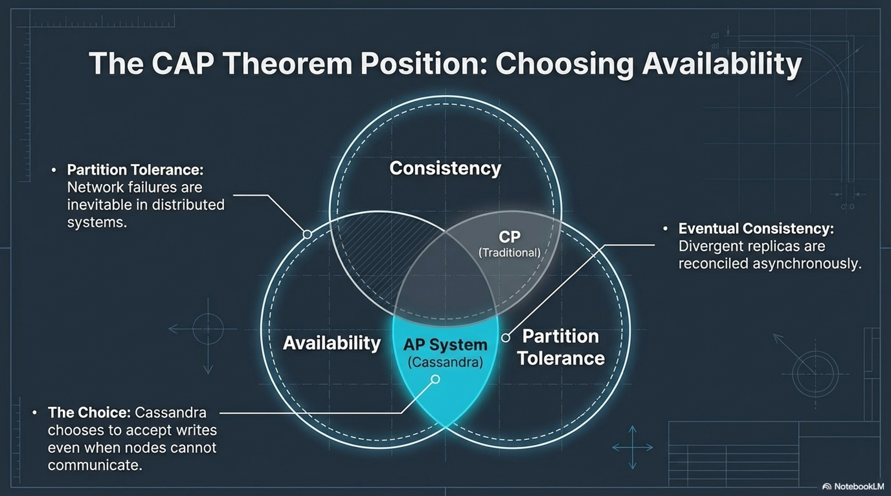
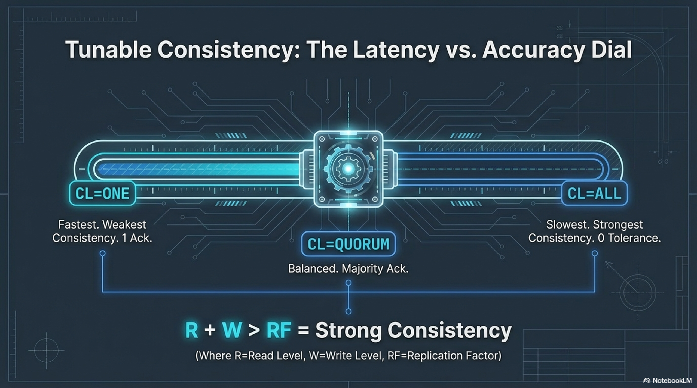
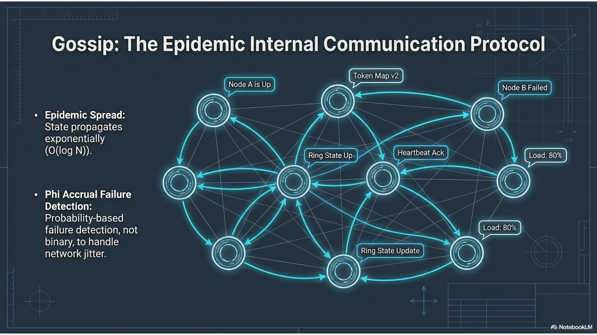
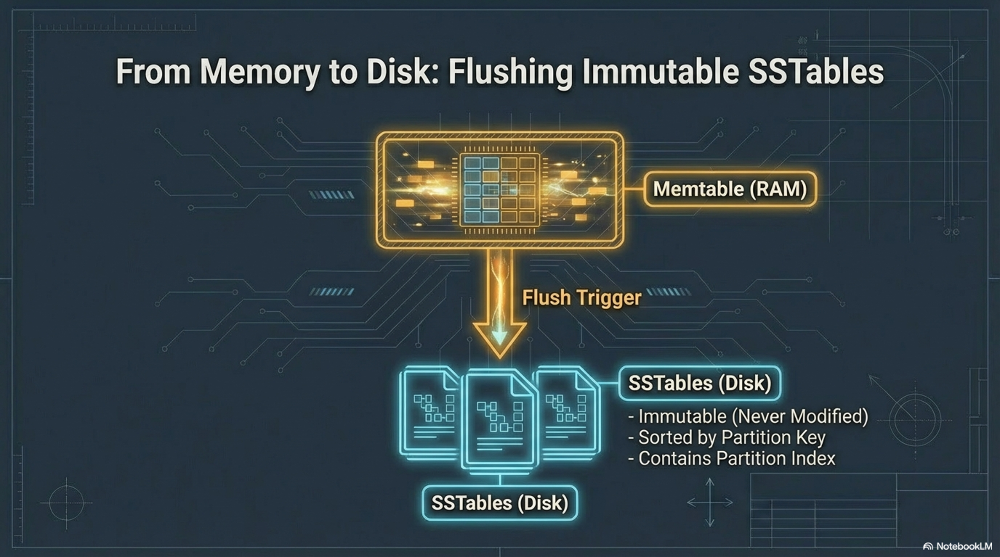
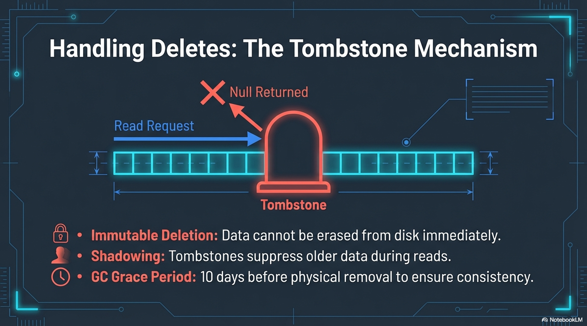
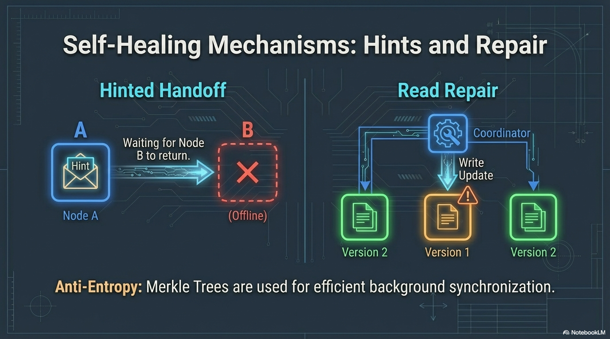
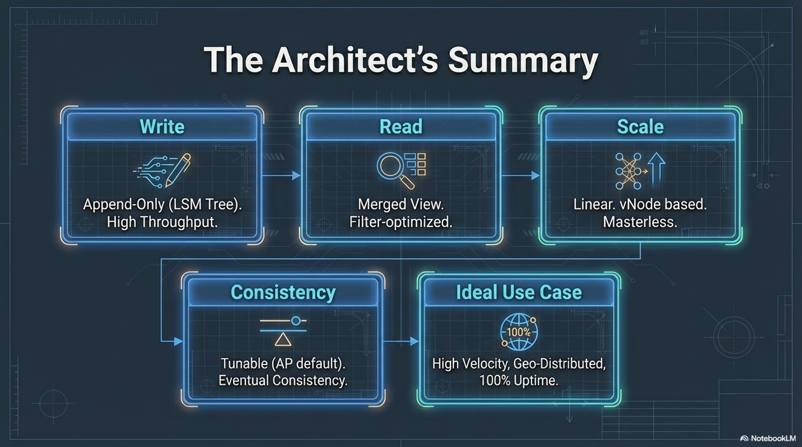

# Session 2 — Consistency, topology, and storage

**Phase 1.** Same audience as session 1.

**Duration:** 2 hours.

**Purpose:** Decide how much agreement a request needs, see how nodes learn membership, and follow one write onto disk. Then stop a node and watch consistency and hints, still on open-source Cassandra.

**Requires:** `lab_ks.events` from [session 1](01-common-foundation.md). The explanation for this session is in this file.

## You leave able to

- Choose `ONE`, `QUORUM` / `LOCAL_QUORUM`, or `ALL` and say what breaks when a node is down.
- Read a snitch and a datacenter, and say why `LOCAL_QUORUM` exists.
- Trace a write: commit log, memtable, SSTable, compaction, tombstone — at architecture depth.
- Name hinted handoff, read repair, and anti-entropy repair, and see a hint directory once.

## Agenda

| Minutes | Block |
|---------|--------|
| 0–20 | CAP and consistency levels |
| 20–45 | Lab — `ONE` vs `QUORUM`, one trace |
| 45–65 | Gossip, snitch, multi-DC |
| 65–80 | Lab — `describecluster` and the snitch |
| 80–100 | Storage engine, plus a flush |
| 100–120 | Lab — one node down |

**If you are behind:** skip the trace in the first lab. Do not skip the node-down lab.

---

## 1. CAP and tunable consistency

CAP names three properties. **Consistency** here means every read sees the latest write. **Availability** means every request gets a non-error response. **Partition tolerance** means the system keeps working when the network drops messages between nodes. Under a partition you cannot maximize all three.

Cassandra is usually described as **AP-leaning**. Nodes keep answering across a partition, and replicas are brought back together afterwards by replication, repair, and the consistency level on each statement. That is **eventual consistency**: divergent replicas reconcile asynchronously. A write may succeed on the side of the partition that is still up. The consistency level is how much agreement you required for that one operation. The default is not “no consistency.” You pick it per read and per write.

For the overlap rule, **R** is how many replicas must answer a read, **W** is how many must acknowledge a write, and **N** is how many replicas hold the data. In one datacenter, N is the replication factor.

| | Formula | What happens |
|--|---------|----------------|
| Can miss the latest write | R + W ≤ N | The read set and the write set might not overlap. A successful read can be stale. |
| Sees the latest successful write | R + W > N | The sets must overlap, if the operation succeeded and the nodes you asked were up. |

For RF = 3, a quorum is 2. `QUORUM` plus `QUORUM` overlaps. `ONE` plus `ONE` does not.

| Level | RF = 3, one DC | Use when |
|-------|----------------|----------|
| `ONE` | 1 replica | Lowest latency, stale reads are acceptable |
| `QUORUM` | 2 of 3 | Default for correctness inside one DC |
| `LOCAL_QUORUM` | Quorum **in the coordinator’s DC** | Production multi-DC. Same as `QUORUM` in this lab |
| `ALL` | Every replica | Rare. Any down replica fails the statement |

DSE uses the same levels. A Search query is not a consistency level; do not treat it as one.





---

## 2. Lab — feel a consistency level

**About 25 minutes.** In `cqlsh` on `cassandra-1`:

```sql
USE lab_ks;

CONSISTENCY ONE;
SELECT * FROM events LIMIT 5;

CONSISTENCY QUORUM;
SELECT * FROM events LIMIT 5;
```

The prompt shows the level. On a healthy cluster both succeed. The difference shows up in the trace and when a node is down.

```sql
CONSISTENCY QUORUM;
TRACING ON;

INSERT INTO events (user_id, event_time, payload)
VALUES (123e4567-e89b-12d3-a456-426614174001, toTimestamp(now()), 'trace-quorum');

TRACING OFF;
```

**You should see** the coordinator write to replicas and wait until quorum acknowledges. Name that in one sentence. A second trace at `ONE` is optional and is the first thing to cut.

---

## 3. Gossip and topology

**Gossip** is how nodes share membership, health, load, schema, and the token map. Each round, a node exchanges state with a few peers, and the news spreads. It is the control plane. Application bytes do not travel by gossip. Routing and repair decisions do.

A naive failure detector says “no heartbeat for X seconds, so the node is dead.” Jitter then marks healthy nodes down. **Phi accrual** keeps a suspicion score instead of a hard cutoff, so a late packet is less likely to convict a live node. The score is probabilistic. That is why the failure lab tells you to wait until `nodetool status` actually shows the node down, and why the first `ALL` write may sit until that happens.

The **snitch** is the plugin that tells Cassandra each node’s rack and datacenter, so replicas are not all placed in one failure domain. `GossipingPropertyFileSnitch` reads that from local configuration. In this Compose file the value is `datacenter1`. `NetworkTopologyStrategy` does not name the snitch class. It names datacenters, and the replica count for each. The string in the keyspace has to be the string the snitch reports, or those replicas are not placed. `SimpleSnitch` throws rack and datacenter information away. `SimpleStrategy` never consults it. This lab is one datacenter on purpose, and it still uses the snitch and the strategy you would keep when a second datacenter appears: add another name and another count, and use `LOCAL_QUORUM` so a request does not wait on the other region. Replication across a wide-area link is often asynchronous.

DSE uses the same gossip and the same snitch model. OpsCenter watches this state. It does not replace it.




---

## 4. Lab — name, partitioner, snitch

**About 15 minutes.** On the host:

```bash
docker exec cassandra-1 nodetool describecluster
docker exec cassandra-1 nodetool gossipinfo | head -40
docker exec cassandra-1 grep -E '^endpoint_snitch' /etc/cassandra/cassandra.yaml
```

**You should see** cluster name `training-lab`, `Murmur3Partitioner`, peer entries in gossip, and `GossipingPropertyFileSnitch`.

`nodetool failuredetector` is optional. Phi values are the suspicion scores from the diagram.

---

## 5. Storage engine, one flush

Writes follow a **log-structured merge** tree. An append-only **commit log** is the durability record. A **memtable** is the sorted in-memory buffer for that table. When the memtable flushes, it becomes a new immutable **SSTable**, sorted by partition key, with indexes. Old SSTables are not edited in place. A crash replays the commit log. Compared with a store that updates pages on disk, this favors sequential writes and high ingest, and it pushes the cost onto reads: several files may hold versions of the same partition, and compaction has to merge them later.




A read looks at the memtable first, then at SSTables. A **Bloom filter** skips files that cannot contain the partition. The **key cache** shortens the index lookup. If several versions exist, **last write wins** by timestamp. Compaction exists so a read does not open a pile of files. **Size-tiered** compaction (STCS) suits write-heavy tables. **Leveled** compaction (LCS) suits read-heavy ones. **Unified** compaction (UCS) adapts, on newer releases. The choice is per table, and it trades write amplification against read cost. Immutability is also why a delete cannot punch a hole in an old file.


A delete writes a **tombstone**, a marker, and it costs like a write. Reads hide the older cells. **`gc_grace_seconds`** is how long that marker must stay before compaction may drop the data, so a replica that was offline can still learn the delete. Often that grace is 10 days. A wide partition full of dead markers is a slow partition. Session 4 labs the delete and TTL. TTL expiry writes a tombstone too. The picture is this one.



**Lab, about 10 minutes.**

```sql
USE lab_ks;
INSERT INTO events (user_id, event_time, payload)
VALUES (aaaaaaaa-bbbb-cccc-dddd-eeeeeeeeeeee, toTimestamp(now()), 'flush-lab');
```

```bash
docker exec cassandra-1 nodetool flush lab_ks events
docker exec cassandra-1 sh -c 'ls /var/lib/cassandra/data/lab_ks/events-*/ | head'
```

**You should see** a `*-Data.db` file. That is the SSTable from the diagram, on this node. Compaction stats and the delete lab are not this hour. The delete is session 4.

---

## 6. Lab — stop one node

**About 20 minutes.** Throwaway cluster only. RF is 3 and every partition includes all three nodes, so `cassandra-3` is a replica for every key.

**Hints and repair, said before you type.** If a replica is down but expected back soon, the coordinator can store a **hint** and replay it when the peer returns. Hints live on the coordinator, not on the dead node. **Read repair** is the other direction: during a read, if replicas disagree, the coordinator can write the latest version back to the stale ones. That costs latency on the read, and it only fixes partitions somebody reads. **Anti-entropy repair** does not wait for a client. `nodetool repair -pr` compares ranges with Merkle trees (hashes of the data) and streams the differences. `-pr` limits the work to the ranges this node owns as a primary replica. You will see the hint directory. You will not run repair in the two hours. The command, when you do, is `nodetool repair -pr lab_ks`. A lightweight transaction is a different mechanism, Paxos on one partition, and session 4 explains it next to the lab. DSE’s repair service schedules anti-entropy repair. The mechanism is still repair.



```bash
docker compose stop cassandra-3
```

Wait until `nodetool status` on `cassandra-1` shows `cassandra-3` as down (often 30–60 seconds). The first statement at `ALL` can sit until a timeout if the failure detector has not convicted the node yet.

In `cqlsh` on `cassandra-1`:

```sql
USE lab_ks;

CONSISTENCY ALL;
INSERT INTO events (user_id, event_time, payload)
VALUES (123e4567-e89b-12d3-a456-426614174010, toTimestamp(now()), 'all-should-fail');
```

That insert fails: `ALL` needs the down replica.

```sql
CONSISTENCY ONE;
INSERT INTO events (user_id, event_time, payload)
VALUES (123e4567-e89b-12d3-a456-426614174011, toTimestamp(now()), 'one-should-succeed');
```

That insert succeeds. The coordinator (`cassandra-1`) should hold a hint for `cassandra-3`:

```bash
docker exec cassandra-1 sh -c 'ls -la /var/lib/cassandra/hints/'
```

Bring the node back:

```bash
docker compose start cassandra-3
docker exec cassandra-1 nodetool status
```

Wait for **UN**. List the hints directory again. Replay is asynchronous; empty immediately is fine, empty a minute later is the point.

Set the shell back before you leave:

```sql
CONSISTENCY QUORUM;
```

**Say this once:** availability won because the client asked for `ONE`. The missing replica catches up from a hint, from read repair, or from `nodetool repair`. DSE’s repair service schedules that last path. The mechanism is still repair.



---

## Close

Three questions, spoken, no new commands:

1. Why is there no master in this cluster?
2. What does RF 3 plus quorum reads and writes guarantee about overlap?
3. Name two ways replicas converge without the client reading (hints, read repair, or anti-entropy repair — any two).

**Next:** Phase 2 starts at [session 3](03-query-driven-design.md). Phase 1 is done.

**Not this session:** primary-range repair, compaction strategy tuning, LWT, TTL, driver code.
