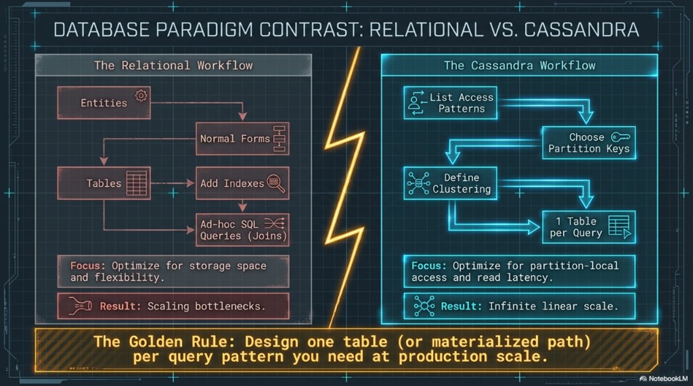
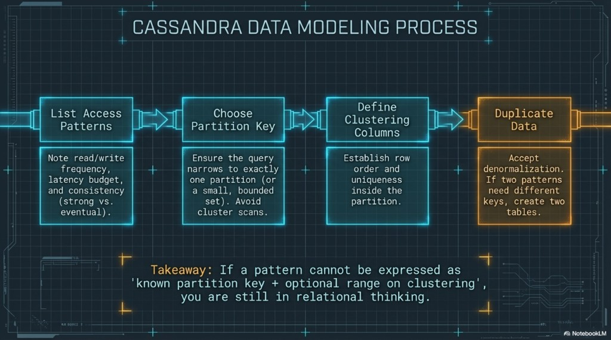
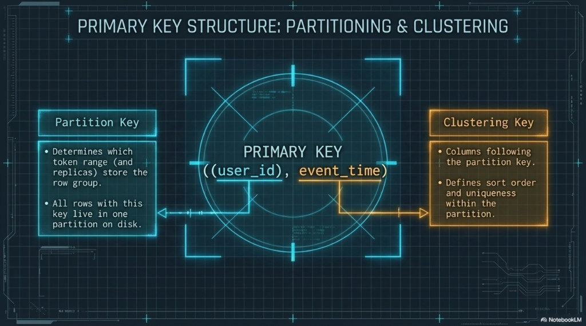
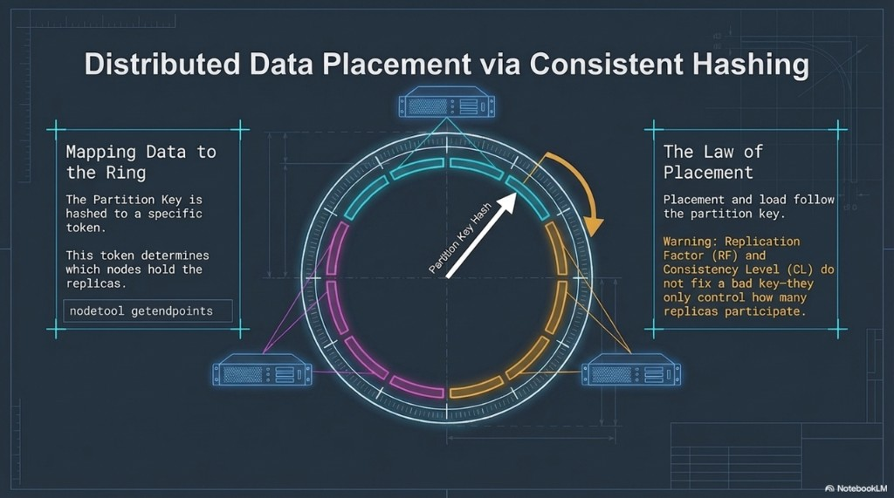
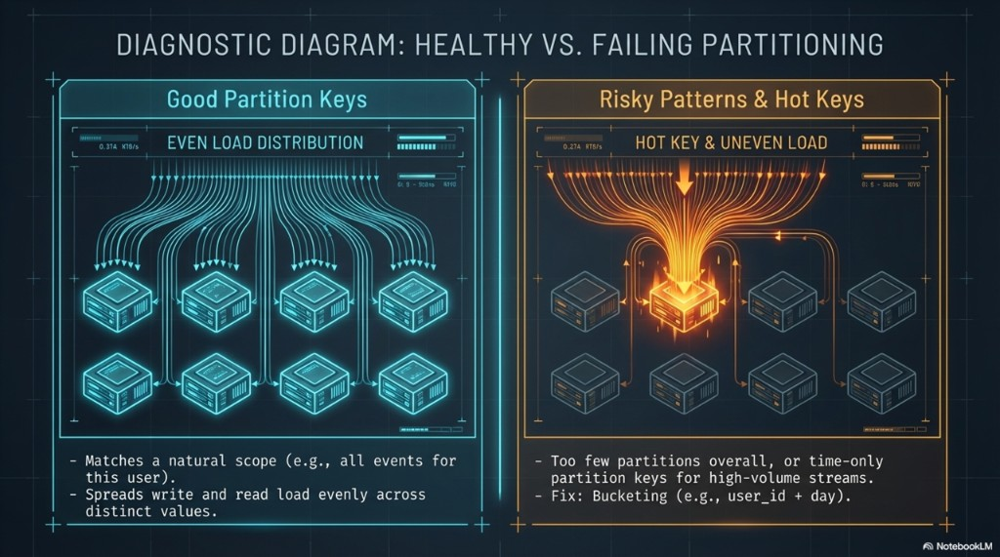
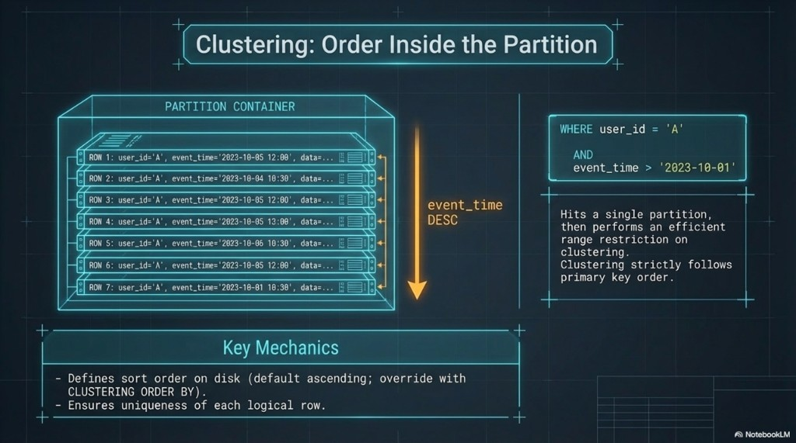
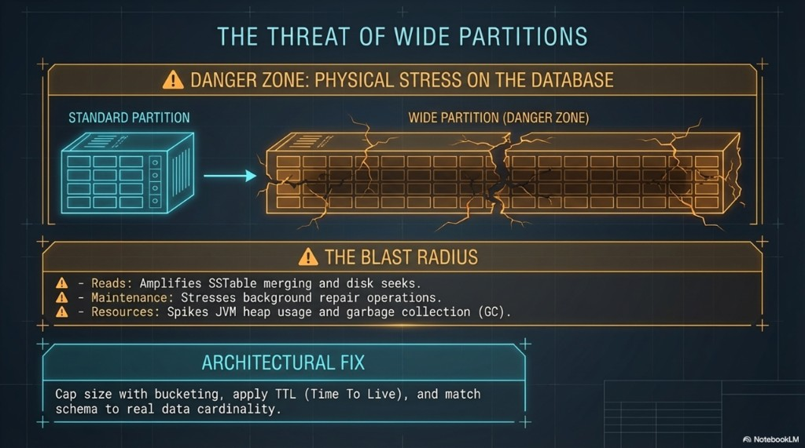

# Session 3 — Query-driven design

**Phase 2.** Development teams, architects, technical leads.

**Duration:** 2 hours.

**Purpose:** Design tables from access patterns so each production query hits a known partition and that partition stays bounded.

**Requires:** Phase 1 vocabulary (partition, RF, CL, SSTable) and `lab_ks.events` from session 1. If this group did not sit Phase 1, spend the first 15 minutes on [session 1, sections 4 and 5](01-common-foundation.md) and cut the optional clustering-order lab below. The explanation for this session is in this file.

## You leave able to

- Reject a design that starts from entities and joins.
- Split a primary key into partition key and clustering columns, including a composite partition key.
- Run the CQL for “this user’s events after time T” and point at the replicas with `getendpoints`.
- Spot a hot or wide partition and name bucketing before you reach for an index.

## Agenda

| Minutes | Block |
|---------|--------|
| 0–20 | Query-first rule |
| 20–40 | Four steps and the primary key |
| 40–75 | Lab — one partition, many rows, one range |
| 75–95 | Hot partitions and wide partitions |
| 95–115 | Lab — endpoints and clustering order |
| 115–120 | Write one query on paper |

**If you are behind:** skip lab B (clustering order). Do not skip the range query.

---

## 1. The rule

The masterless, log-structured cluster from the first two sessions only stays fast when the tables match how data is stored: partitions on the ring, append-only writes, a consistency level per statement.

A relational design identifies entities, normalizes them to cut redundancy, creates tables, adds indexes, and then runs whatever SQL the question needs, including joins. The win is storage efficiency and flexible querying. At large scale the joins and the central bottlenecks become the constraint.

Cassandra reverses the order. List the access patterns first. Choose partition keys so each query hits a known partition, or a small bounded set. Define clustering for the order inside that partition. At production scale that is often one table per query. The win is partition-local reads and predictable latency. Duplicating a value is acceptable when it buys that.

**Golden rule:** one table, or one materialized path, per access pattern you need at production scale. If the pattern cannot be written as a known partition key plus an optional range on the clustering columns, in order, you are still thinking in rows and joins. You need another table, a different key, or a different store.



---

## 2. Four steps, then the key

Work in this order. Skipping to a table and hoping indexes will save the second query is the relational habit.

1. **Access patterns.** For each one, write the frequency, the latency budget, and whether the read must see the latest write. That last part is the consistency level from session 2: `LOCAL_QUORUM` or `QUORUM` when it must, `ONE` when it may not.
2. **Partition key.** The query narrows to one partition, or to a small bounded set. A cluster-wide scan is not a step you accept.
3. **Clustering columns.** They set row order and uniqueness inside the partition. `event_time DESC` is how “latest first” is stored, not how a query sorts after the fact.
4. **Another table** when a second pattern needs a different partition key. Session 4 writes both. Duplication is the design. The database will not normalize it back.



`events` is already step 2 and 3 for “this user’s events, ordered by time”:

```sql
PRIMARY KEY (user_id, event_time)
```

A **composite** partition key groups columns in extra parentheses. All of them are hashed together; clustering still follows:

```sql
PRIMARY KEY ((user_id, day), event_time)
```

That is how you stop one user from owning an unbounded partition when history is long. `(day)` alone is the opposite problem: every writer for “today” hits one partition. Session 4’s day table uses `(day, bucket)` for that reason.

The primary key has two jobs, and they are not the same job.

- The **partition key** is hashed to a token. That token decides which replicas store the partition. Every row with that partition key lives in one partition on disk. A single column is a simple partition key: `PRIMARY KEY (user_id, event_time)`. Several columns in an extra pair of parentheses are one composite partition key: `PRIMARY KEY ((user_id, day), event_time)`. All of those columns are hashed together.
- The **clustering columns** follow the partition key. They sort the rows on disk, ascending unless `CLUSTERING ORDER BY` says otherwise, and they make each row unique inside the partition.

Partitioning answers where the data lives in the cluster. Clustering answers the order inside that one partition. The poster draws extra parentheses around `user_id`. The table you created does not need them. The parentheses matter when more than one column is the partition key.



---

## 3. Lab — describe, insert, range

**About 35 minutes.** `cqlsh` on any node:

```sql
USE lab_ks;
DESCRIBE TABLE events;
```

Name the partition key and the clustering column from the output before you insert.

Pick one UUID and reuse it. Three rows, same user, different comments:

```sql
INSERT INTO events (user_id, event_time, payload)
VALUES (123e4567-e89b-12d3-a456-4266141740bb, '2024-06-01 12:00:00+0000', 'morning');

INSERT INTO events (user_id, event_time, payload)
VALUES (123e4567-e89b-12d3-a456-4266141740bb, '2024-06-01 15:00:00+0000', 'afternoon');

INSERT INTO events (user_id, event_time, payload)
VALUES (123e4567-e89b-12d3-a456-4266141740bb, '2024-06-02 09:00:00+0000', 'next-day');

SELECT * FROM events
WHERE user_id = 123e4567-e89b-12d3-a456-4266141740bb;
```

Rows come back in `event_time` order. That order was fixed at schema time.

```sql
SELECT * FROM events
WHERE user_id = 123e4567-e89b-12d3-a456-4266141740bb
  AND event_time > '2024-06-01 13:00:00+0000';
```

**You should see** two rows, not a scan of other users. The partition key is equality. The clustering column is a range. Both predicates are required in that order. A filter on `payload` is session 4’s anti-pattern, not this query.

---

## 4. Hot partitions and wide partitions

The partition key is hashed to a token, and that token selects the replicas. You already saw the endpoints in session 1. The modeling consequence is blunt: **placement and load follow the partition key.** Raising RF or picking a stricter consistency level does not spread a bad key. Those knobs only change how many of the replicas participate in one operation.

A good key matches a natural query (“this user’s events”) and has enough distinct values that reads and writes spread out. The risky shapes are too few distinct values, and a time-only key on a high-volume stream: everything “current” lands on one partition until the bucket rolls.

A **hot** partition is one key taking a disproportionate share of operations. Its replicas run hot. The rest of the cluster looks idle. A **wide** partition is one key with a huge number of rows or a huge payload. Reads merge more SSTable components. Repair and compaction cover more. Coordinators and replicas spend more heap and more garbage-collection time.

Mitigations you should be able to say:

- **Bucketing** — add a bucket or a time shard to the partition key: `(user_id, day)` when one user is huge, or `(day, bucket)` when the query is “this day.” A bare `day` is the hot key, not the fix.
- **TTL** — only when the product may forget the row. Session 4 labs it. Expiry becomes a tombstone, so it is not free, and expiring a whole partition at once schedules a delete storm.
- **Cardinality** — “one row per country” or “one partition per current hour for the whole product” will not scale. Model the volume you will actually have. Unbounded growth under one key is a design bug unless you have measured otherwise.









Clustering supports `=`, `>`, `<`, and `BETWEEN` in primary-key order. It does not sort by an arbitrary column at read time.

---

## 5. Lab — where it lives, and DESC order

**About 20 minutes.**

**A. Endpoints.** Same key as the inserts above, from the host:

```bash
docker exec cassandra-1 nodetool getendpoints lab_ks events 123e4567-e89b-12d3-a456-4266141740bb
```

Say which part of the primary key was hashed (only `user_id`) and which part only ordered rows (`event_time`).

Insert a **second** user id (change the last hex digit) and run `getendpoints` again if you want to see that another key can map to the same three nodes in this three-node RF-3 lab. In a larger cluster the sets differ. Do not “fix” a model because this lab returned every node.

**B. Optional — `CLUSTERING ORDER BY`.** Cut this first if the clock is short.

```sql
CREATE TABLE IF NOT EXISTS dm_cluster_demo (
  demo_id uuid,
  seq int,
  note text,
  PRIMARY KEY (demo_id, seq)
) WITH CLUSTERING ORDER BY (seq DESC);

INSERT INTO dm_cluster_demo (demo_id, seq, note)
VALUES (123e4567-e89b-12d3-a456-426614174000, 1, 'first');
INSERT INTO dm_cluster_demo (demo_id, seq, note)
VALUES (123e4567-e89b-12d3-a456-426614174000, 2, 'second');

SELECT * FROM dm_cluster_demo
WHERE demo_id = 123e4567-e89b-12d3-a456-426614174000;
```

`2` comes back before `1`. “Latest first” in a UI is a schema choice, not an `ORDER BY` you invent in the query. `event_time DESC` is the same idea on a real events table.

---

## 6. Paper check (5 minutes)

Write the CQL, not the prose, for: **the 20 latest events for one known user**.

A passing answer restricts `user_id` with equality. Latest-first needs `CLUSTERING ORDER BY (event_time DESC)` on the table, or the application reverses an ascending result and risks reading more than 20 rows. `LIMIT 20` without the partition key is not an answer.

---

## Close

**Next:** [Session 4](04-cql-drivers-performance.md) — the second table, tombstones, TTL, the driver, and the queries you must not ship.

**Not this session:** `ALLOW FILTERING`, index creation, dual writes, Python. The paper check above is the close.
