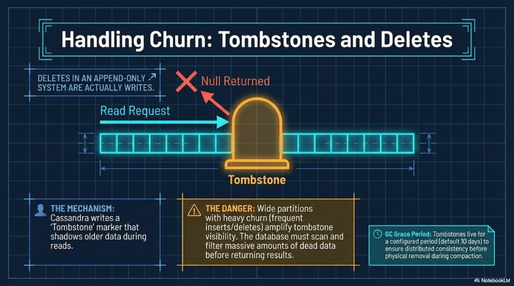
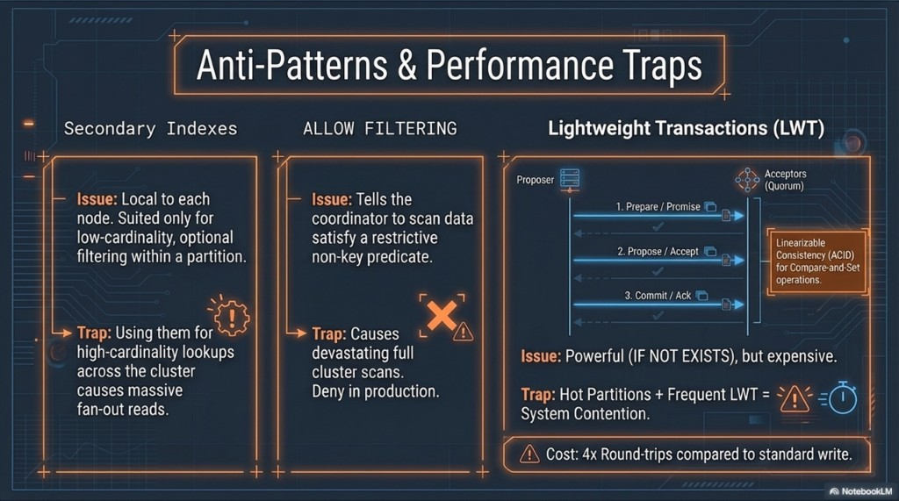
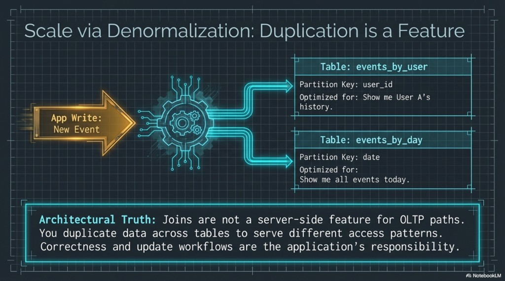
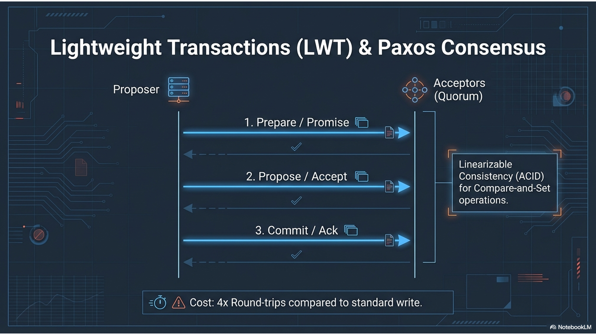

# Session 4 — CQL, drivers, tombstones, TTL

**Phase 2.** Same audience as session 3.

**Duration:** 2 hours.

**Purpose:** Write the CQL and the driver calls that keep a query-driven model fast: upserts, paging, prepared statements, tombstones, TTL, a second table, and the traps (`ALLOW FILTERING`, secondary index as the main path, hot LWT).

**Requires:** `lab_ks.events` and the three rows for user `123e4567-e89b-12d3-a456-4266141740bb` from session 3. Labs still use open-source Cassandra. The driver settings are the same ones you point at DSE. The explanation for this session is in this file. The Python file you run is `labs/driver_basics.py`.

## You leave able to

- Treat `INSERT` and `UPDATE` as upserts, and restrict queries the way the storage engine requires.
- Explain a delete tombstone versus a TTL expiry.
- Fan a write out to two tables whose partition keys serve two queries, with a bucket so “one day” is not one partition.
- Reject `ALLOW FILTERING` and a cluster-wide secondary index as the design for a hot path.
- Open a token-aware, DC-aware driver session and run a prepared statement at `LOCAL_QUORUM`.

## Agenda

| Minutes | Block |
|---------|--------|
| 0–20 | CQL the application actually sends |
| 20–45 | Lab — delete tombstone and TTL |
| 45–70 | Lab — second table, dual write |
| 70–95 | Lab — filtering and one LWT |
| 95–120 | Drivers, then the Python lab |

**If you are behind:** skip the LWT statements. Do not skip TTL or the driver.

---

## 1. CQL for this model

CQL looks like SQL and then refuses the habits SQL allows.

- **Upsert.** `INSERT` and `UPDATE` write cells. A second write with the same primary key overwrites by timestamp (last write wins). There is no read-before-write unless you add `IF`.
- **Partition key equality is mandatory** on `SELECT` and on most `UPDATE` / `DELETE` forms. Clustering predicates come next, in order, with no gap.
- **No joins.** The second query is a second table. You write both.
- **Batches are not a bulk loader.** An **unlogged** batch groups writes to **one partition**. A **logged** batch coordinates writes across partitions and is expensive; do not use it to import data. The dual write in the next lab is two statements (or a logged batch only if you have measured it). The application still owns consistency if one statement fails.
- **Paging belongs in the driver.** A coordinator will page a large partition. The application sets a fetch size and does not pull a wide partition into one response. `LIMIT` without a partition key does not make a query safe.
- **Prepare once.** Parse on the server, bind values, set consistency on the statement. String-concatenated CQL hides both the query shape and the consistency level.
- **Consistency is a statement property.** Schema replication is RF. The driver chooses `LOCAL_QUORUM` (or `ONE`) per call. On DSE you use the same DataStax drivers and the same levels; you change contact points and local DC, not the modeling rules.

A few CQL features exist and are not the way through this model. **Collections** (`list`, `set`, `map`) store a small nested value inside one cell. They are a poor place to hide a growing history. **Counters** are a special column type with their own limits and merge rules, not a general integer you increment. **User-defined types** bundle columns under one name. None of them remove the need for a partition key you know in advance. The language manual, when you want syntax rather than another lab, is the [Cassandra CQL reference](https://cassandra.apache.org/doc/stable/cassandra/cql/). Data modeling as a longer essay, same idea as this session, is the [Cassandra data modeling guide](https://cassandra.apache.org/doc/stable/cassandra/developing/data-modeling/index.html).

---

## 2. Lab — tombstone and TTL

**About 25 minutes.**

Cassandra is append-only, which session 2 established. A delete is not an in-place erase. It is a write of a **tombstone**. Reads merge live cells and tombstones, and last write wins by timestamp. The marker stays visible to the storage engine for **`gc_grace_seconds`**, often 10 days, so a replica that was offline can still learn the delete. Only then may compaction discard the data. Until then, a wide partition with heavy insert and delete churn forces reads to reconcile a lot of dead markers, and latency suffers. Pair partition size with the delete strategy. TTL is that strategy when the product is allowed to forget the row: a deadline on the write. When it elapses, the server writes a tombstone, and the same grace period applies. A table-level `default_time_to_live` does this for every write that does not set its own TTL. TTL does not bound a hot key. If every row in one partition expires together, you scheduled a delete storm.

```sql
USE lab_ks;

INSERT INTO events (user_id, event_time, payload)
VALUES (123e4567-e89b-12d3-a456-426614174099, '2020-06-01 12:00:00+0000', 'dm05-delete-me');

DELETE FROM events
WHERE user_id = 123e4567-e89b-12d3-a456-426614174099
  AND event_time = '2020-06-01 12:00:00+0000';

SELECT * FROM events
WHERE user_id = 123e4567-e89b-12d3-a456-426614174099;
```

The row is gone from the result. The SSTable from session 2 was not edited in place.

**TTL** is how you drop data the product is allowed to forget (sessions, ephemeral events). You do not wait 60 seconds in the room. `TTL()` shows the countdown. When it hits zero, Cassandra writes a tombstone, and `gc_grace_seconds` applies again. TTL does not fix a hot key; it schedules a delete storm if every row in one partition expires together.

```sql
CREATE TABLE IF NOT EXISTS ttl_demo (
  id text PRIMARY KEY,
  payload text
);

INSERT INTO ttl_demo (id, payload) VALUES ('short', 'gone-soon') USING TTL 60;

SELECT id, payload, TTL(payload) FROM ttl_demo WHERE id = 'short';
```

**You should see** a positive `TTL(payload)` under 60. A table-level `default_time_to_live` does the same for every write that does not set its own TTL. Leave `events` without a default TTL.



---

## 3. Lab — two queries, two tables

**About 25 minutes.**

Joins are not how this database serves operational reads. If you need “by user” and “by day,” you keep two tables and duplicate the columns each query must return. One application write fans out to both, in the request path or in a pipeline. Correctness of that pair is the application’s job. The database will not notice that one of the writes failed.

“Events for this user” is `events`. “This slice of this day, newest first” cannot use `user_id` as the partition key. A partition key of `day` alone collects the whole day onto one replica set. Add a **bucket** (in production, `hash(user_id) % N`). Include `user_id` in the clustering key so two events at the same timestamp both survive. The duplication costs disk and discipline. It buys a partition-local read for each pattern. A DSE Search index is not a stand-in for the second table.

```sql
CREATE TABLE IF NOT EXISTS events_by_day (
  day text,
  bucket int,
  event_time timestamp,
  user_id uuid,
  payload text,
  PRIMARY KEY ((day, bucket), event_time, user_id)
) WITH CLUSTERING ORDER BY (event_time DESC, user_id ASC);

INSERT INTO events (user_id, event_time, payload)
VALUES (123e4567-e89b-12d3-a456-4266141740bb, '2025-04-01 10:00:00+0000', 'dual-write');

INSERT INTO events_by_day (day, bucket, event_time, user_id, payload)
VALUES ('2025-04-01', 0, '2025-04-01 10:00:00+0000', 123e4567-e89b-12d3-a456-4266141740bb, 'dual-write');

SELECT payload FROM events
WHERE user_id = 123e4567-e89b-12d3-a456-4266141740bb
  AND event_time = '2025-04-01 10:00:00+0000';

SELECT user_id, payload FROM events_by_day
WHERE day = '2025-04-01' AND bucket = 0
LIMIT 20;
```

**You should see** `dual-write` from both tables. The application writes both on the success path and has a story for the failure of the second write (retry, log, repair job). Cassandra will not keep them aligned for you. The same fan-out applies on DSE; a Search index is not a substitute for the table that serves the known query.



---

## 4. Lab — traps

**About 25 minutes.**

Convenience becomes a full-cluster read, or a contended partition.

A **secondary index** is distributed, with a catch. The classic form is tolerable for a narrow, low-cardinality case, or a query that is already scoped. “Find this email anywhere in the database” on a high-cardinality column fans out to many nodes. The fix for a primary lookup is a table whose partition key is that lookup. **Storage-attached indexes** (SAI) are the newer form: default `CREATE INDEX` on Cassandra 5, and available in DSE. They avoid a lot of the coordinator fan-out of the classic index. They are still not a substitute for a key you know before you query. This lab does not create one.

**`ALLOW FILTERING`** tells the coordinator it may scan to satisfy a predicate that is not the partition key. On a large table that scan is the partition, or the cluster. If the statement needs it, the schema is wrong for that query.

A **lightweight transaction** (`IF`, `IF NOT EXISTS`) is a linearizable compare-and-set. Cassandra runs it as a Paxos-style round, several network trips, on the order of four times a normal write. It is the right tool for a narrow conditional update. It is the wrong tool for keeping two denormalized tables aligned, and it is a latency trap when the same partition takes a stream of them. Prefer an idempotent write and a partition key that spreads the work. Cassandra 5 adds **Accord** for multi-partition transactions. That is a separate write path from ordinary inserts and from single-partition LWT. It does not make filtering, an unbounded partition, or a careless driver cheap. This course does not lab Accord.

```sql
SELECT * FROM events WHERE payload = 'dual-write';
```

This fails. The coordinator will not scan the cluster for a non-key column.

```sql
SELECT * FROM events WHERE payload = 'dual-write' ALLOW FILTERING;
```

This can succeed here because the table is tiny. On a real table it is a scatter-gather. Shipping it means the access pattern never got a table.

Do **not** “fix” it with `CREATE INDEX ON events (payload)` as the hot path. A classic secondary index fans out across nodes. Storage-attached indexes (SAI), the default index form in Cassandra 5 and available in DSE, are more efficient and still are not a substitute for a partition key you know in advance. If the lookup is primary, build `events_by_payload` or an equivalent key.



**LWT, one compare-and-set.** Skip if the clock slipped. The rounds are the picture. The legitimate use in this course is the narrow conditional write below, not a transaction around `events` and `events_by_day`.



```sql
CREATE TABLE IF NOT EXISTS dm_lwt_demo (
  id uuid PRIMARY KEY,
  v int
);

INSERT INTO dm_lwt_demo (id, v)
VALUES (123e4567-e89b-12d3-a456-4266141740aa, 0) IF NOT EXISTS;

INSERT INTO dm_lwt_demo (id, v)
VALUES (123e4567-e89b-12d3-a456-4266141740aa, 0) IF NOT EXISTS;
```

The first result has `[applied]` true, the second false. That is the entire legitimate use in this course: a narrow conditional write, not a transaction around `events` and `events_by_day`.

---

## 5. Drivers

**About 25 minutes.** Concepts, then the script.

The driver is where Phase 1’s rules become code:

| Knob | Lab setting | Why |
|------|-------------|-----|
| Contact points | `127.0.0.1:9042` (`cassandra-1`) | Bootstrap only. The driver discovers the other nodes |
| Load balancing | Token-aware around DC-aware round robin, local DC `datacenter1` | Send the request to a replica in the local DC when you can |
| Consistency | `LOCAL_QUORUM` on the prepared statements | Same overlap rule as session 2. In this single DC it matches `QUORUM` |
| Prepared statement | Insert and select by `user_id` | One parse, bound values |
| Fetch size | Default is large; set it down for big partitions | Paging is the driver’s job |

Retries: the driver retries some coordinator failures on another node. It must not blindly retry a non-idempotent write. Default policies are a starting point, not something to invent in the last ten minutes.

DSE: same driver, same policies. Contact points and `local_dc` change. You do not get a different modeling API because OpsCenter is installed.

**Lab.** From the repository root, on the host (Python 3):

```bash
pip install cassandra-driver
python labs/driver_basics.py
```

The script inserts one row at `LOCAL_QUORUM` and reads it back. Read [`labs/driver_basics.py`](../labs/driver_basics.py) while it runs; the policies are the lesson, not the printout.

**You should see** `driver-lab` and `LOCAL_QUORUM`. If it cannot find `lab_ks`, session 1’s schema was not created.

---

## Close

Pre-flight, answered for `events` and `events_by_day`:

1. What is the exact CQL for each hot path?
2. Is every read partition-scoped?
3. Which partition could grow without a bound, and what is the bucket?
4. Where is TTL or delete churn, and who pays for the tombstones?
5. What did the driver set for local DC and consistency?

**Not this session:** an Accord lab, SAI syntax drills, repair, multi-DC failover, a DSE cluster. The reasons are in the sections above.
